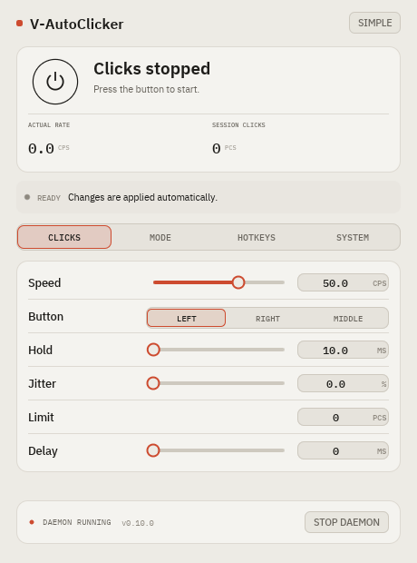
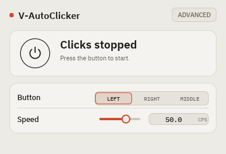
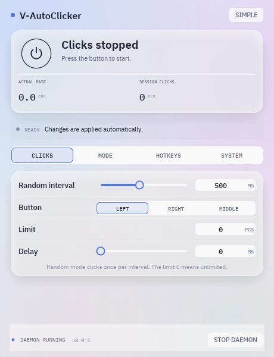

<p align="center">
  <a href="https://github.com/savvhurt/V-AutoClicker/releases">
    
  </a>
  <a href="https://github.com/savvhurt/V-AutoClicker/releases/latest">
    
  </a>
  <a href="https://github.com/savvhurt/V-AutoClicker/stargazers">
    
  </a>
  <a href="https://github.com/savvhurt/V-AutoClicker/blob/main/LICENSE">
    
  </a>
</p>

<div align="center">

# V-AutoClicker

**A fast, minimal, lightweight autoclicker written on Rust for Windows and Linux.**<br>
Native input, four click modes, nineteen themes, one small binary.

[Download](https://github.com/savvhurt/V-AutoClicker/releases/latest) ·
[CLI](#cli) ·
[Build from source](#build-from-source)



</div>

## Highlights

- **0.2-1000 CPS** with hold duration, jitter, start delay and a per-session limit.
- **Cursor, Point, Sequence and Random modes** - click where the mouse is, at
  fixed coordinates, through up to 16 points in order, or at random points
  across the whole desktop.
- **Simple and Advanced layouts** - a compact Start/Stop panel or the full
  tabbed interface, switchable at any time.
- **Eyedropper** for capturing coordinates; single, double and triple clicks.
- **Global hotkeys** on Windows, compositor bindings on Linux.
- **Hold-to-click** on Windows with a second hotkey.
- **Autostart** on both platforms, plus optional **minimize to tray** on Windows.
- **Always on top** on Windows and X11, with a pin in the top bar.
- **Built-in updates**: the System tab checks GitHub, verifies the SHA-256 and
  installs a new version in place.
- **19 themes**, including the experimental **Liquid Glass**, six interface
  languages and automatic DPI scaling.
- **One binary**: no arguments opens the GUI, subcommands stay on the CLI.
- Settings live in `gui.toml` and are saved automatically.

Clicks are injected by the OS: `SendInput` on Windows, `/dev/uinput` on Linux
(Wayland and X11). No drivers and no administrator rights required.

## Download

Grab the latest archive from the
[releases page](https://github.com/savvhurt/V-AutoClicker/releases/latest):

| Platform | Archive |
|---|---|
| Windows 10/11 x86_64 | `v-autoclicker-windows-x86_64.zip` |
| Linux x86_64 | `v-autoclicker-linux-x86_64.tar.gz` |

Both archives contain the binary, this README and `FONT-LICENSE.txt`.

## Linux

### Quick install

```bash
tar -xzf v-autoclicker-linux-x86_64.tar.gz
mkdir -p ~/.local/bin
install -m 755 v-autoclicker-linux-x86_64/v-autoclicker ~/.local/bin/
```

Make sure `~/.local/bin` is in `PATH`, then run:

```bash
v-autoclicker
```

### Allow access to `/dev/uinput`

```bash
test -w /dev/uinput && echo "uinput: writable"
```

If the check fails, load the module and add a udev rule:

```bash
sudo modprobe uinput
```

Create `/etc/udev/rules.d/99-uinput.rules`:

```udev
KERNEL=="uinput", SUBSYSTEM=="misc", MODE="0660", GROUP="input", TAG+="uaccess"
```

Then reload the rules and log in again:

```bash
sudo udevadm control --reload-rules
sudo udevadm trigger
```

On CachyOS/niri access is usually configured through ACL; after a kernel update
you may need `sudo modprobe uinput` again.

### Autostart and hotkey

Enable **Start at login** in the **System** tab. The app writes
`~/.config/autostart/v-autoclicker.desktop`, installs a launcher entry and a
256×256 icon.

On Wayland global keys belong to the compositor. **niri** example:

```kdl
binds {
    Mod+Alt+C { spawn "v-autoclicker" "toggle"; }
}
```

For GNOME or KDE create a custom shortcut with the command `v-autoclicker toggle`.
Do not use `Mod+Shift+C` in niri: it is already bound to `center-column`.

### Point, sequence and random modes

Point, sequence and random modes use `XWarpPointer`. They work on X11 and
XWayland but not in native Wayland windows; the GUI shows a notice on Wayland.

Random mode ignores CPS, hold, jitter and multi-click: it simply waits for the
**Random interval** (10-60000 ms) and clicks once at a random point. The button,
session limit and start delay still apply. Points are kept 8 px away from the
edges and cover every monitor, including negative virtual-desktop coordinates.

## Windows

### Quick start

1. Download and extract `v-autoclicker-windows-x86_64.zip`.
2. Run `v-autoclicker.exe`. The GUI opens.
3. Press the power button, or use the default hotkey **Ctrl+Alt+C**.

No installer, drivers or administrator rights are needed. SmartScreen may warn
about an unsigned binary.

### Hotkeys, tray and autostart

- The global hotkey is recorded on the **Hotkeys** tab and applied live.
- A second key can start clicking while held (**hold-to-click**).
- **Minimize to tray** hides the window when it is closed instead of quitting;
  the minimize button still uses the taskbar. **Exit** in the tray menu always
  stops the daemon.
- **Start at login** writes the per-user value `V-AutoClicker` under
  `HKCU\Software\Microsoft\Windows\CurrentVersion\Run`.

### Windows limitations

- Elevated windows and games ignore input from a non-elevated process (UIPI).
  The GUI warns at startup and can restart itself as administrator.
- Some anti-cheat systems block synthetic input.
- If the process is force-killed, the mouse button may stay pressed. Stop with
  `off`, `quit` or the hotkey instead.

## CLI

```bash
v-autoclicker                 # open the GUI
v-autoclicker toggle          # start the daemon if needed and toggle clicking
v-autoclicker on              # start clicking
v-autoclicker off             # stop clicking
v-autoclicker status          # state, measured CPS and hotkeys
v-autoclicker quit            # stop the daemon
v-autoclicker daemon --detach # background daemon
```

One-off run (Ctrl+C stops):

```bash
v-autoclicker run --cps 50 --button left --hold-ms 10
v-autoclicker on --cps 100 --button right --limit 200 --delay-ms 1500
v-autoclicker on --cps 20 --multi-click 2 --x 640 --y 360
```

| Option | Default | Description |
|---|---:|---|
| `--cps N` | `50` | Clicks per second, `0.2-1000` |
| `--button left\|right\|middle` | `left` | Mouse button |
| `--hold-ms MS` | `10` | Button hold time, `0.1-5000` |
| `--jitter-pct PCT` | `0` | Random interval deviation, `0-100` |
| `--limit N` | `0` | Clicks per session; `0` means unlimited |
| `--delay-ms MS` | `0` | Delay before a new session, `0-10000` |
| `--multi-click N` | `1` | Clicks per pulse: `1`, `2` or `3` |
| `--x X`, `--y Y` | - | Fixed point; both are required together |
| `--duration-secs SECS` | - | `run` only: stop after N seconds |
| `--hotkey COMBO` | `ctrl+alt+c` | Windows only, applied live |
| `--hold-hotkey COMBO` | - | Windows hold-to-click key |
| `--detach` | - | `daemon` only: continue in the background |

Sequence and random mode intervals are configured in the GUI.

## GUI and themes

The GUI has two layouts. **Simple** keeps only Start/Stop, the session state,
the mouse button and the speed slider on one compact screen; in Random mode the
speed slider becomes the random interval. **Advanced** is the full interface
with the **Clicks**, **Mode**, **Hotkeys** and **System** tabs. The
Simple/Advanced toggle is always visible in the top bar, and the choice is saved
in `gui.toml`. The pin in the top bar toggles **Always on top**; the same switch
is available in the **System** tab.

Always on top is supported on **Windows** and **Linux/X11**. On Wayland the
compositor owns window stacking (and niri has no always-on-top action), so the
control is hidden there instead of silently doing nothing.

<p align="center">
  
</p>

Settings apply live, including while clicking.

The window opens at 380×260 in Simple and 460×560 in Advanced (460×600 on
Linux, where the daemon footer takes the extra row). A tiling compositor may
override this: on **niri** the GUI is tiled by default, so the compact size only
applies when the window floats. To keep it at the designed size, add:

```kdl
window-rule {
    match app-id="v-autoclicker"
    open-floating true
}
```

Available themes:

| Light | Dark |
|---|---|
| Paper, Sand, Contrast, Rose, Lavender, Coffee, Glacier, Apricot, Mint, Liquid Glass | Graphite, Ocean, Forest, Midnight, Nord, Matcha, Ember, Plum, Wine |

**Liquid Glass** is an experimental theme: a soft gradient backdrop with color
blobs, translucent cards and rounded frosted surfaces. The glass is simulated
inside the app, so it does not depend on OS blur and looks the same on every
compositor.

<p align="center">
  
</p>

Languages: Auto, English, Русский, Deutsch, Français, Español, Português.
Auto follows the system locale and falls back to English.

Settings are stored in:

- Linux: `~/.config/v-autoclicker/gui.toml`
- Windows: `%APPDATA%\V-AutoClicker\gui.toml`

### Updates

The **System** tab has an **Updates** row with the current version, a
**Check for updates** button and a **Check at startup** switch (enabled by
default). The check reads the latest GitHub release. A failing startup check
stays silent; only a manual check shows the error.

When a newer version exists, **Release notes** opens the GitHub page and
**Install update** downloads the raw binary and verifies it against the
published `SHA256SUMS` file. Installing asks for confirmation, stops clicking,
shuts the daemon down and restarts the app with the new binary:

- On Linux the running executable is replaced atomically. Its directory must be
  writable; for example, installing to `/usr/local/bin` without permission
  reports an error instead of asking for a password.
- On Windows the running `.exe` is renamed aside, the new one is put in its
  place, and the leftover file is removed on the next launch. SmartScreen may
  warn because the binary is not code-signed.

Development builds (`cargo run`) can check for updates but cannot install them.

## Build from source

Requires Rust 1.92+ for the GUI (the CLI builds on older versions).

```bash
git clone https://github.com/savvhurt/V-AutoClicker.git
cd V-AutoClicker
cargo build --release --features gui
```

CLI only:

```bash
cargo build --release
```

The binary is at `target/release/v-autoclicker` (`v-autoclicker.exe` on Windows).

### Linux build dependencies

| Distribution | Command |
|---|---|
| Arch / CachyOS | `sudo pacman -S --needed base-devel pkgconf` |
| Debian / Ubuntu | `sudo apt install build-essential pkg-config` |
| Fedora | `sudo dnf install gcc make pkgconf-pkg-config` |
| openSUSE | `sudo zypper install -t pattern devel_basis` |

### Windows build dependencies

Install [Rust](https://rustup.rs) with the MSVC toolchain and
[Visual Studio Build Tools](https://visualstudio.microsoft.com/visual-cpp-build-tools/)
with **Desktop development with C++**.

```powershell
rustup default stable-msvc
cargo build --release --features gui
```

### Cross-compiling for Windows from Linux

```bash
rustup target add x86_64-pc-windows-msvc
cargo install cargo-xwin
cargo xwin build --release --features gui --target x86_64-pc-windows-msvc
```

The result is
`target/x86_64-pc-windows-msvc/release/v-autoclicker.exe`.

## How it works

- Absolute `Instant` deadlines keep the schedule stable; a short spin-loop
  removes the last fraction of a millisecond.
- The mouse button is released on stop, Ctrl+C and daemon shutdown.
- A single daemon instance is controlled through a Unix socket or a Windows
  named pipe.
- Windows uses `SendInput`; Linux creates a virtual mouse through
  `/dev/uinput`, with X11 `XWarpPointer` for fixed-point movement.
- The GUI renders in software: no GPU driver or video memory required.
